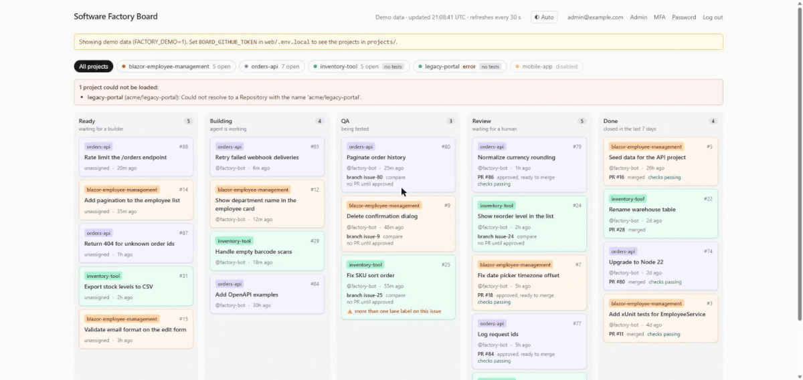

# Software Factory

[](https://github.com/bartvanhoey/software-factory-board/actions/workflows/ci.yml)

A software factory that runs in a Docker container and uses Claude Code to turn GitHub issues into pull requests.
The factory comes with a web application that shows:

- **Issue Board:** every issue in its lane, from `ready` to `done`.
- **Issue creation:** create an issue for an enabled project directly from the board.
- **Users:** who may log in, and with which role.
- **Projects:** the GitHub repositories the factory works on.

Create an issue and optionally label it `ready` (the web form can do both). The software factory then:

1. **Builds** it with Claude Code on its own branch.
2. **Tests** it.
3. **Reviews** it, and opens a pull request only if the review approves.

A person always does the final merge. The web application sits behind a login, so only people you approve can see it.



## Getting Started

1. Clone the repository and go into its folder, the project root:

   ```bash
   git clone https://github.com/bartvanhoey/software-factory-board.git
   cd software-factory-board
   ```

2. Create a file named `.env` in the project root with the variables below. This is the minimum; `.env.example` lists the optional ones.

   ```bash
   # Random secrets, one value each: node -e "console.log(require('crypto').randomBytes(32).toString('base64'))"
   MFA_ENCRYPTION_KEY=<random base64 value>
   RUNNER_API_TOKEN=<another random base64 value>

   # Your first administrator (password: 12 to 128 characters)
   ADMIN_EMAIL=you@example.com
   ADMIN_PASSWORD=<a strong password>

   # Needed only for the factory to build; leave empty to just look around
   CLAUDE_CODE_OAUTH_TOKEN=<your Claude Code token>

   # GitHub tokens: separate tokens, never reuse one for another
   RUNNER_GITHUB_TOKEN=<token the factory builds with: writes branches, issues and pull requests>
   BOARD_GITHUB_TOKEN=<read-only token for the board; leave empty to see demo data>
   CREATE_ISSUE_GITHUB_TOKEN=<optional token for creating issues from the board>

   # Plain http on localhost
   COOKIE_SECURE=false
   
   # Scheduler: runs the lanes (review, qa, build) automatically for every project that is switched on in the web app.
   # Off by default. Once on, it builds issues labelled "ready" with your tokens, so turn it on on purpose.
   # It never merges a pull request.
   SCHEDULER_ENABLED=true
   # Minutes to wait after a pass ends before the next one starts (1 to 1440).
   SCHEDULER_INTERVAL_MINUTES=5
   # A single run is stopped after this many minutes (1 to 170).
   SCHEDULER_RUN_TIMEOUT_MINUTES=120

   ```

   **Claude Code token:** install [Claude Code](https://claude.com/claude-code), run `claude setup-token` and follow the login. It prints a long-lived token (it needs a Claude subscription).

   **GitHub tokens:** create separate fine-grained tokens at <https://github.com/settings/personal-access-tokens/new>. For each one, under *Repository access* choose *Only select repositories* and pick the repositories the factory will work on. Then under *Repository permissions* set exactly this and leave everything else on *No access*:

   | Repository permission | `RUNNER_GITHUB_TOKEN` | `BOARD_GITHUB_TOKEN` | `CREATE_ISSUE_GITHUB_TOKEN` |
   | --- | --- | --- | --- |
   | Issues | **Read and write** | Read-only | **Read and write** |
   | Pull requests | **Read and write** | Read-only | No access |
   | Contents | **Read and write** | Read-only | No access |
   | Commit statuses | No access | Read-only | No access |

   The board token must never be able to write: it only displays what is on GitHub. `CREATE_ISSUE_GITHUB_TOKEN` is optional and only for issue creation; issues are authored by the token's GitHub account, not the logged-in board user.

3. Start it from the project root, the folder that contains `docker-compose.yml` and your `.env` file:

   ```bash
   docker compose up -d --build
   ```

   Run every later `docker compose` command from this same folder.

4. Open <http://localhost:2999> and log in with the administrator you set. You will be asked to choose a new password.

5. Add your GitHub repositories on the **Projects** screen and switch them on.

The scheduler is switched on in the example above, so the factory builds `ready` issues of every switched-on project by itself. To stop that, set `SCHEDULER_ENABLED=false` in `.env` and run `docker compose up -d`.

## Install from Docker Hub

No source code or build needed: see [Install from Docker Hub](docs/docker-hub-install.md).

## Learn more

The full description (roles, MFA, the scheduler, configuration and known limits) is in [docs/project-description.md](docs/project-description.md).
